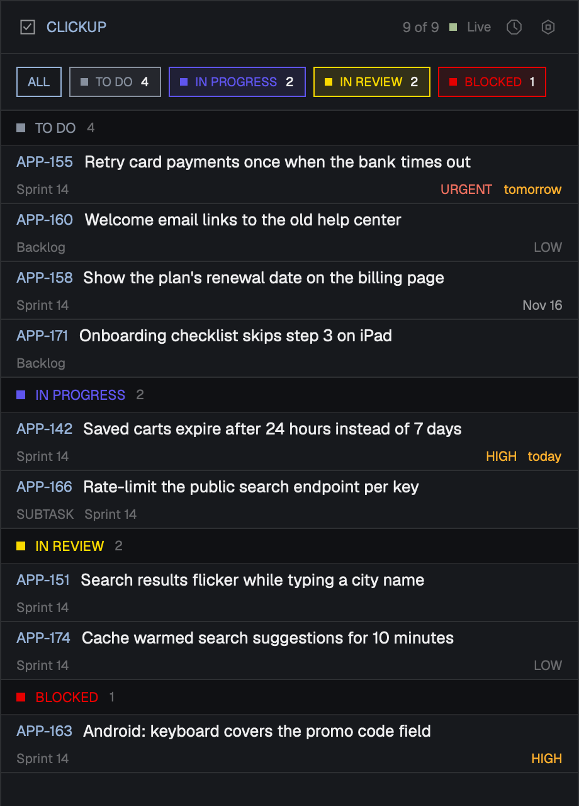

# ClickUp for Herdr

A [Herdr](https://herdr.dev) side panel with the ClickUp tasks assigned to you, grouped by status, with a toggle per status across the top. Click a task to read it right there: its description, comments and their replies, its status, priority and custom fields. You can comment on it and move it to another status. Its **AI** button opens a new space with an agent that reads the task first and waits. Its **START** button opens one that runs a command of yours on it, such as a slash command that sets up a branch and a plan.

It works in any layout: it takes the colors of your theme and the font of your layout. In the [Nightdrive](https://github.com/BenGlasser/herdr-nightdrive) layout its titles take Nightdrive's pixel face, and Nightdrive's pane headers get a ClickUp button that opens the ticket a pane is working on.

## Install

The simplest way is to ask the agent in your Herdr window:

> Add the Herdr mod from https://github.com/BenGlasser/herdr-clickup

Or do it by hand:

1. Copy `mods/clickup/` to `~/.config/herdr-app/mods/clickup/`.
2. Run `herdr-app check ~/.config/herdr-app/mods/clickup`.

Herdr docks it on the right of the layout you're in, the first time it sees it. Herdr's shipped layouts are read-only, so it waits for one of your own; make one with `herdr-app do layout.clone '{"name":"main","as":"my-layout"}'`.

## Setup

The first time the panel opens it asks for a ClickUp **personal API token** (ClickUp → your avatar → Settings → Apps; it starts with `pk_`). It's checked with ClickUp, then kept in your system keychain: the macOS Keychain, or the Secret Service on Linux (service `clickup-feed`, account `api.clickup.com`).

The ⚙ in its header opens its settings:

| Setting | Meaning |
|---|---|
| **New spaces open in** | The folder AI and START open a task's space in (`~` is your home). Blank: the folder of the space that's showing. |
| **Agent** | The program to start in that space, with any arguments. Blank: `claude`. |
| **START sends** | The first message for the agent. `{id}` is the task's number, `{url}` its link, `{name}` its name; with none of them, the number goes at the end. Blank: no START button. |
| **Fields shown** | Custom fields shown as chips on a task, by name, comma-separated. Blank: every drop-down or label field that's set. |

A layout can seed these once through the block's props: `{ "folder": "~/code", "start": "/my-plugin:start-task {id}", "fields": "Team, Area", "team": "Acme" }`. `team` picks the workspace by name or id (default: your first).

AI and START only ever start an agent in a space they open. A task that already has a space (one they opened, or any with the task's number in its name) goes to that space, and nothing is typed there. With several, a dialog asks which.

## What it accesses

- **Network:** ClickUp's API (`https://api.clickup.com/api/v2`): who you are, your workspaces, the tasks assigned to you (every 3 minutes while the panel shows), and a task's details, list statuses and comments when you open it. It writes only when you post a comment or confirm a new status. It never creates or deletes a task.
- **Programs:**
  - `security` (macOS) or `secret-tool` (Linux), to read and keep the token
  - `open` (macOS) or `xdg-open` (Linux), to open a task in ClickUp
  - `hc get`, to tell when each of a task's spaces was opened, for the dialog
- **Files:** none outside its own folder.

It works on macOS and Linux.

## More

[`RECIPE.md`](RECIPE.md) is the full brief: the exact look, behavior, API calls, limits, and checks that prove a build works. An agent can rebuild the mod from it in an empty folder.

## License

[MIT](LICENSE).
