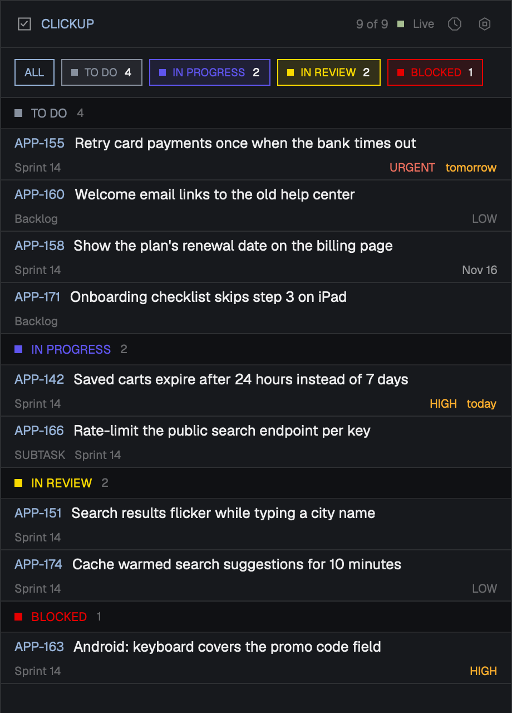

# ClickUp

A side panel with the ClickUp tasks assigned to you, grouped by status, with a toggle per status across the top. Clicking a task opens it in the panel: description, comments and replies, status, priority and custom fields, a comment box, and a status picker that asks before it moves the task. A task's **AI** button opens a space with an agent that reads the task and waits; its **START** button (once a START command is set) opens one that sends that command. It works in any layout, taking the theme's colors and the layout's font, with Nightdrive's titles in a Nightdrive layout.

## What you see

The panel fills its block. Colors are theme names; the values in brackets are Herdr's default `graphite` theme, which the preview shows. Text is the layout's UI font at 13px in `foreground` unless said otherwise.

- **Frame:** `background` with a 1px `border` all round (none when the panel is a tab of its own).
- **Titles** (`look.js`): a title is the layout's UI font, bold, at its size + 3.5px, in `accent`. In a layout whose theme is `nightdrive`, it's `//` in `solid` and then the text in Press Start 2P at its size (8px for headers, 7.5px for group names), and dialogs get Nightdrive's corner marks: four 12×2 / 2×12 bars in `solid` at the top-left and bottom-right.
- **List header, 42px**, 14px side padding, 8px gaps, a `border` line under it: a 14px task icon in `muted`; the title `CLICKUP`; a spacer; `<shown> of <all>` at 11px in `dim`; a 6px square and the state word at 10.5px in `dim` (**Connecting** `dim`, **Error** `ansi1`, **Live** `ansi2`); a 13px clock icon (refresh, `accent` while reading); a 13px gear (settings).
- **Toggles**, 12px/10px padding, 6px gaps, wrapping, a `border` line under it: **ALL** (24px, 10px bold; `accent` border and text while every status shows), then one chip per status your tasks are in, in board order. A chip is 24px with 8px padding: a 6px square and the status name in capitals, 10px bold, then its count. On: the status's own ClickUp color for border, text and square, with a 12% tint behind. Off: `border` and `dim`, the square an outline.
- **Groups:** a 28px `chrome` bar per shown status: a 7px square and the name in the status color (as a title at 7.5px), then the count at 10.5px in `dim`. Under it its tasks, most urgent first, then the soonest due, then the most recently changed.
- **Task rows,** 46px, 12px side padding, a `border` line under each, `hover` background under the pointer:
  - line 1: the task's number (`APP-155`; ClickUp's own id with `#` when there's none) at 11.5px bold in `accent`, then its name at 13px, truncated
  - line 2, 10.5px: `SUBTASK` in `dim` for subtasks; the list's name in `dim`; the priority in capitals unless normal (`URGENT` in `blocked`, `HIGH` in `#ffb02e`, `LOW` in `dim`); the due date (`today`, `tomorrow`, `Nov 16`; `blocked` when late, `#ffb02e` when soon, else `muted`)
  - while hovered and a START command is set: a **START** button (26px, a play icon) over the row's right end on a `hover` strip
- **Empty states,** 12.5px `muted` in 14px padding: "Reading your ClickUp tasks…", "ClickUp: <error>", "Nothing is assigned to you.", or "Every status is turned off. Turn one on above, or press ALL." Under the list: an error strip at 11px `ansi1`, and "Showing the first 1000 tasks." at 11px `dim` when it stopped there.
- **Task view** (a task open):
  - **Header, 42px:** ◂ (back to the list; not in a tab of its own); the task's number as a title; a spacer; **AI** (sparkle icon; its border and text `accent` while the task has a space); **START** (filled `solid`, only when a START command is set); **FULL TAB**; ↗ (open in ClickUp); refresh. Below 470px wide the buttons show only their icons. Buttons are 26px, 10px bold, 8px padding, a 1px `border` that turns `accent` on hover.
  - **Body,** 14px padding, 12px gaps: the name at 16px bold; a line at 11px in `dim` with the list name, `DUE <date>` (colored as on the rows), the assignees and "opened by <name> <time> ago"; then chips with 10.5px bold `dim` labels: `STATUS` (a chip in the status color with ▾; click for the list's other statuses), `PRIORITY` (its ClickUp color), and one per custom field shown (each option in its color; "not set" as a dim outline).
  - **Moving a task:** picking a status shows a box with a `solid` border and tint: "Move APP-142 from in progress to in review?", "ClickUp may notify the people on this task.", **CANCEL** and **MOVE** (MOVING… while it goes).
  - `DESCRIPTION` as a section title, then the task's markdown (selectable), or "No description."
  - `COMMENTS` with a count, then one card per comment, oldest first: the author in their ClickUp color, bold, and the time ago in `dim`; the text as markdown. "2 replies ▸" opens a comment's replies as indented cards. "The latest 25. Older ones are on ClickUp." when there may be more.
  - **Composer,** pinned at the bottom: a 70px text box ("Leave a comment"; `accent` border while typing), "Posts to APP-142 on ClickUp." in `dim`, and **COMMENT** (filled; dim until there's text). A note strip above it shows what happened.
- **Token form** (no token yet): "Connect ClickUp", how to get a personal token, "Open ClickUp's Apps settings ↗" in `accent`, a 32px masked input (`pk_…`) and a 32px **Save** in `solid`, and any problem in `ansi1`.
- **Settings view** (⚙): a header with the gear, the title `CLICKUP SETTINGS` and **DONE**; one line on what AI and START do; four labeled 30px fields (labels 11px bold `accent`, notes 11px `dim`): **NEW SPACES OPEN IN**, **AGENT**, **START SENDS**, **FIELDS SHOWN**, each saving when you leave it or press Enter.
- **Space dialog** (a task open in several spaces): a dialog with a 1px `accent` border on `popover`: the task's number as a title and "Esc to cancel", "APP-142 is open in 3 spaces. Which one?", then a 40px row per space: a 18px square with its first letter, its name (`accent` for the one showing, with `SHOWING`), and "opened 2h ago".

## How it behaves

- **Agent status:** the panel shows none.
- **Reading:** on start, and every 3 minutes while the panel is on screen (it checks every 30 seconds), it reads you, your workspace (`team` prop: a name or id; default your first) and every task assigned to you there that isn't closed, subtasks included, 100 a page, at most 10 pages. While hidden it doesn't read; when it shows again it reads at once.
- **Toggles:** click a status to hide or show its group; ALL shows every status. Hidden statuses are kept in shared state (`clickup.hidden`).
- **Opening a task:** click a row. ⌥-click opens it in a tab of its own (`tab.new` with this mod and props `{ task, ref }`); FULL TAB does the same from the task view and the panel goes back to the list.
- **Moving and commenting:** a status pick asks first, then `PUT`s the new status and reloads the task. COMMENT posts the text and reloads the comments. Nothing else changes on ClickUp.
- **AI:** goes to the task's space if it has one. Otherwise it opens a new space named after the task (its tab named after the task's name, cut to 40 characters), in the settings' folder, running the settings' agent, whose first message asks it to read the task through ClickUp (description, comments, custom fields), summarize it and wait.
- **START:** the same, but the first message is the START command with `{id}`, `{url}` and `{name}` filled in (with none of them, the task's number goes at the end). Hidden while no START command is set.
- **A task's spaces:** the one AI or START opened for it (kept in shared state `clickup.task-spaces`, by space id, so renaming it keeps it), plus any whose name has the task's number as a word (`APP-142`, `fix app-142 cart`). One: AI and START go there. Several: the space dialog asks. Going to a space only shows it; nothing is started or typed there. A second click within 4 seconds is ignored.
- **Settings:** shared state `clickup.settings` `{ folder, agent, start, fields }`, shared by every copy. A layout's props `{ folder, agent, start, fields }` seed it once, when it's empty.
- **Other mods:**
  - it answers shared `clickup.open` `{ ref, block, at }` (a pane's ClickUp button asking for a task): the copy whose `block` matches opens that task, once per ask, within 30 seconds of it
  - it publishes the task-number prefixes it has seen in shared `clickup.prefixes` (like `["APP"]`), so other mods can spot ticket numbers in text
- **Token:** a token ClickUp turns down shows the token form again with "ClickUp turned down the saved token. Paste a new one." A 401 for a single task the token can't see doesn't.
- **Motion:** none.

## Built from

- **Files:** `mods/clickup/`
  - `main.js`: the panel, the task tab and the space dialog, one `View`
  - `tickets.js`: pure helpers (task and comment shapes, status order, sorting, due dates, custom-field chips: `picked`, `setFields`)
  - `look.js`: titles and dialog corners (`face`, `title`, `reticle`), Nightdrive's only in a `nightdrive`-themed layout
  - `mod.json`: `{ "place": "right", "size": 420, "title": "ClickUp" }`
  - icons (24×24 strokes in `currentColor`): `tickets.svg`, `start.svg` (play), `ai.svg` (sparkle), `zoom.svg`, `clock.svg`, `settings.svg`
- **Props** (all optional): `block` (its id in the layout, for the visibility check; default `clickup`), `team`, `folder`, `agent`, `start`, `fields`; `{ task, ref }` for a task's own tab; `{ choose }` for the space dialog; `dock: true` when it's a panel of Nightdrive's panel dock (it then asks shared `dock` whether it shows).
- **Herdr APIs:** `props()`, `theme()`, `layout()`, `spaces()`, `panes()`, `window()` (`platform`), `shared()` / `setShared()`, `run` (`space.new`, `space.select`, `tab.new`), `openOverlay` / `closeOverlay` (the dialog: kind `dialog`, frame `none`, 460 wide), `hc(["get", terminal, "--json"])` (`created_ms`), `exec`, `fetch`, `cx.spawn`, `cx.timer.every`; from `gpui-base`: `InputState` + `Input`, `TextareaState` + `Textarea`, `TextView.markdown`, `Scrollbar`.
- **Network** (`https://api.clickup.com/api/v2`, header `Authorization: <token>`):
  - `GET /user`, `GET /team`
  - `GET /team/<id>/task?page=N&assignees[]=<you>&subtasks=true&include_closed=false&order_by=updated`
  - `GET /task/<id>?include_markdown_description=true` (with `&custom_task_ids=true&team_id=<id>` for a task number like `APP-142`)
  - `GET /list/<id>` (its statuses), `GET /task/<id>/comment`, `GET /comment/<id>/reply`
  - `PUT /task/<id>` `{ status }`, `POST /task/<id>/comment` `{ comment_text, notify_all: false }`
- **Programs:**
  - macOS: `security find-generic-password -s clickup-feed -a api.clickup.com -w`, `security add-generic-password -U -s clickup-feed -a api.clickup.com -w <token>`, `open <url>`
  - Linux: `secret-tool lookup service clickup-feed account api.clickup.com`, `secret-tool store … service clickup-feed account api.clickup.com` (the token on stdin), `xdg-open <url>`
  - `hc get <terminal> --json`

## Watch out

- **401s:** ClickUp answers 401 for a bad token but also for one task the token can't see ("Team not authorized"). Only drop the token when `GET /user` fails too.
- **Task numbers:** `APP-142` isn't a task id. Look it up with `custom_task_ids=true&team_id=…`, then use the task's own id from then on.
- **Custom fields:** a drop-down's value is an option's id or its `orderindex`; a labels field's value is a list of option ids. Map both.
- **State that lasts:** keep settings, hidden statuses and a task's spaces in shared state. A mod copy's own storage starts over whenever its props change, and a panel, its tab copies and a dock's copy are separate copies.
- **Rendering:** no `cx.notify()` during `render`; `InputState` and `TextareaState` are made in `init`, never in `render`.
- **Inputs:** stop the mouse-down on every text box (`cx.stop_propagation()`), or a press drags the panel when it's in a window.
- **Spaces by name:** match the number as a word (`(^|[^\w-])#?APP-142(?![\w-])`, ignoring case), so `APP-14` doesn't match `APP-142`.
- **Limits:** 1000 tasks, the latest 25 comments, a 3-minute refresh.

## Done when

- `herdr-app check mods/clickup` passes.
- With no token: the token form; `abc` gives "ClickUp personal tokens start with pk_."; a made-up `pk_` token gives "ClickUp turned that token down (HTTP 401)." and nothing is kept.
- With a valid token: **Live**, your open tasks grouped by status in board order, the toggles hide and show groups, and ALL brings every one back.
- Clicking a task shows its description and comments; ⌥-click opens it in a tab of its own.
- Picking a status asks first; CANCEL leaves it; MOVE changes it on ClickUp.
- A comment posted from the panel shows on the task in ClickUp.
- With no START command, there's no START on rows or in the task view; with `/my-plugin:start-task {id}` set, START opens a space named after the task in the set folder, and its agent's first message is `/my-plugin:start-task APP-142`.
- AI on a task with no space opens one whose agent is asked to read the task and wait; on a task with one space it shows that space and types nothing; with two, the dialog lists both with when each was opened.
- After a read, shared `clickup.prefixes` holds your tasks' prefixes.
- In a Nightdrive layout the titles are pixel type with `//`; in Herdr's default layout they're the UI font.
